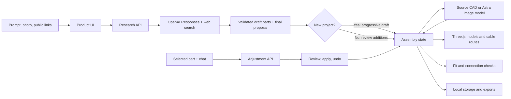

# Architecture

Phygital Studio is a browser-first hardware workbench. Its six examples load
without AI: makeup cyberdeck, thermal camera, air monitor, wearable haptics,
smartwatch and smart ring. The original unwanted-surveillance detector remains
an isolated reference project. The application does not run that device's firmware.

## Boundaries



The frontend is plain JavaScript with Vite, Three.js and CSS. Supabase provides Google authentication and private project/chat storage; no React router is involved. Vercel's
Node functions wrap the same handlers used by `server/dev.mjs` locally.

## State and geometry

`engine.js` owns validation, state cloning, placement and fit checks.
`catalog.js` and specialized part modules provide the library. An instance stores
an ID, position, rotation and editable dimensions. Custom parts are held in the
project; duplicated catalog parts retain `modelId` for shared CAD. Mutations are
undoable and autosaved. Import validation normalizes records and rejects invalid
coordinates, contacts and arbitrary model paths.

`routes.js` defines starter URLs and storage keys. `templates.js` creates their
initial state. Changes to defaults must not silently overwrite user-edited
projects. The watch's guarded battery upgrade is an example of a narrow migration.

The viewer loads checked-in GLBs, then falls back to a dimension box on failure.
Blender and OpenCascade are authoring tools, not runtime dependencies. Cable
paths are visual planning routes between normalized contacts. Bounding-box fit
warnings do not model deformation, connector insertion or material tolerances.

## Research, chat and progress

`POST /api/research` accepts a mode (`project`, `parts`, `link`), prompt, optional
image/public links, catalog and assembly context. The visitor key arrives in the
Authorization header and is relayed only to OpenAI. `server/schema.mjs` bounds
input and validates the final structured proposal. The configured model is in
`server/research.mjs`; a fork must use a model its API account can access.

Clients requesting `Accept: application/x-ndjson` receive allowlisted progress
records followed by a validated result or error. The server consumes Responses
SSE; web-search events increment a deduplicated count, output-text events mark
proposal preparation, and completion begins validation. Validated complete part objects are also emitted as `type: part`. Other model text,
queries and reasoning are not forwarded. JSON clients remain supported.

```json
{"type":"progress","phase":"searching","searches":1}
```

Final records are `{ "type": "result", "data": { "proposal": {} } }` or
`{ "type": "error", "error": "Readable message" }`. Authentication/input
errors before streaming retain their HTTP status and JSON error body. Client
cancellation aborts the upstream request. The client rejects interrupted streams.

`POST /api/adjust` uses a bounded assembly snapshot, selected part and the last
eight chat messages plus a server-owned catalog and exact port IDs. It can propose
part additions/duplicates/removals, individual cable conductors, placements, notes
and enclosure changes. New aliases are resolved within one atomic reviewed edit;
physical port and power checks reject invalid wiring. A question contains 2–4
options, with Other supplied by the UI, and cannot include assembly changes.
Application checks the original base state and preserves undo. It cannot order
parts, run commands or modify firmware.

## Persistence and hosting

Each workspace has separate browser autosave, snapshots and chat history (last
40 messages). API keys live only in tab memory. JSON export moves projects between
browsers; CSV exports contact-level wiring, and GLB exports planning geometry.

`saved-projects.js` discovers autosave records directly under known project keys
instead of maintaining a second index. It ignores chat/snapshot/unrelated keys,
keeps unreadable records, and sorts valid projects by saved modification time.
`/projects/local-<uuid>` identifies independent copies and imports. Creation
validates the document, writes to a new key before navigation, and never replaces
the source. A single atomic storage write preserves the previous save on quota
failure. Old root saves remain accessible through `/?workspace=1`. Account caches
are excluded from anonymous discovery. `cloud-projects.js` uses Google PKCE auth
and RLS-protected Supabase reads/RPC writes. `/projects/cloud-<uuid>` requires the
owner identity. Serialized writes check revisions; network failures keep drafts,
conflicts stop writes and preserve both versions. See [ACCOUNTS.md](ACCOUNTS.md).

Vercel Web Analytics is injected in production for page views. OAuth callback
pages are excluded so authorization codes and tokens cannot enter page-view URLs.
No custom events record prompts, keys, images, project contents or chat messages.
Local development does not load Analytics. Hosting settings live in `vercel.json`;
forks should link their own Vercel project and configure their own public domain.

## Progressive project creation and model pipeline

`project-build.js` opens a generated route before connecting or requesting work.
`part-stream.mjs` tracks JSON depth and string escapes to emit only complete
validated objects from the root parts array. Each draft uses stable identities;
the final proposal reconciles placements and wires without losing prepared
models. Editing is locked while building; orbit, selection and Stop remain
available. Find-parts additions and chat adjustments retain their review step.

Catalog parts reuse their known models. New parts try a public source CAD URL
through `assets.mjs`, then a referenced image through `model.mjs` and Astra.
No usable image means an envelope, not a claimed reconstruction. Source CAD,
image-derived geometry and failure notes survive project serialization; images
and credentials do not. CAD blobs are cached in memory and re-fetched on reload,
with a SHA-256 match required. STEP parsing runs in a disposable browser worker.

Cancel aborts research and model requests, retains draft parts, and unlocks
editing. Reload marks running builds interrupted and never silently re-bills.
Signed-out builds use an isolated localStorage namespace. Signed-in builds use
a new private cloud project and an account-scoped local cache.
