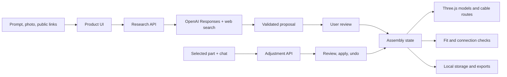

# Architecture

Phygital Studio is a browser-first hardware workbench. Its six examples load
without AI: makeup cyberdeck, thermal camera, air monitor, wearable haptics,
smartwatch and smart ring. The original unwanted-surveillance detector remains
an isolated reference project. The application does not run that device's firmware.

## Boundaries



The frontend is plain JavaScript with Vite, Three.js and CSS. No React router,
database, account system or shared conversation backend is involved. Vercel's
Node functions wrap the same handlers used by `server/dev.mjs` locally.

## State and geometry

`engine.js` owns validation, state cloning, placement and fit checks.
`catalog.js` and specialized part modules provide the library. An instance stores
an ID, position, rotation and editable dimensions. Custom parts are held in the
project; duplicated catalog parts retain `modelId` for shared CAD. Mutations are
undoable and autosaved. Import validation normalizes records and rejects invalid
coordinates, contacts and arbitrary model paths.

`routes.js` defines starter URLs and storage keys. `templates.js` creates their
initial state. Changes to defaults must not silently overwrite user-edited
projects. The watch's guarded battery upgrade is an example of a narrow migration.

The viewer loads checked-in GLBs, then falls back to a dimension box on failure.
Blender and OpenCascade are authoring tools, not runtime dependencies. Cable
paths are visual planning routes between normalized contacts. Bounding-box fit
warnings do not model deformation, connector insertion or material tolerances.

## Research, chat and progress

`POST /api/research` accepts a mode (`project`, `parts`, `link`), prompt, optional
image/public links, catalog and assembly context. The visitor key arrives in the
Authorization header and is relayed only to OpenAI. `server/schema.mjs` bounds
input and validates the final structured proposal. The configured model is in
`server/research.mjs`; a fork must use a model its API account can access.

Clients requesting `Accept: application/x-ndjson` receive allowlisted progress
records followed by a validated result or error. The server consumes Responses
SSE; web-search events increment a deduplicated count, output-text events mark
proposal preparation, and completion begins validation. Intermediate model text,
queries and reasoning are not forwarded. JSON clients remain supported.

```json
{"type":"progress","phase":"searching","searches":1}
```

Final records are `{ "type": "result", "data": { "proposal": {} } }` or
`{ "type": "error", "error": "Readable message" }`. Authentication/input
errors before streaming retain their HTTP status and JSON error body. Client
cancellation aborts the upstream request. The client rejects interrupted streams.

`POST /api/adjust` uses a bounded assembly snapshot, selected part and the last
eight chat messages. It returns only proposed geometry/enclosure/note changes.
Application checks the original base state and preserves undo. It cannot order
parts, run commands, modify firmware or independently alter connection maps.

## Persistence and hosting

Each workspace has separate browser autosave, snapshots and chat history (last
40 messages). API keys live only in tab memory. JSON export moves projects between
browsers; CSV exports contact-level wiring, and GLB exports planning geometry.

Vercel Web Analytics is injected in production builds for standard page views.
No custom events record prompts, keys, images, project contents or chat messages.
Local development does not load Analytics. Hosting settings live in `vercel.json`;
forks should link their own Vercel project and configure their own public domain.
